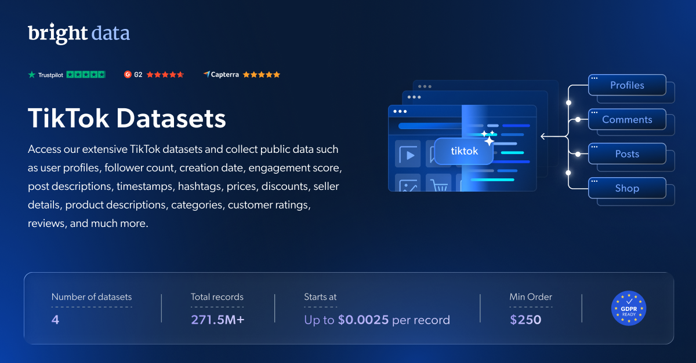

# TikTok 数据集样本

<h2>包含 1001 个 TikTok 个人资料的样本数据集</h2>

<a href="https://www.bright.cn/products/datasets/tiktok">
   
</a>

包含超过 1000 个个人资料的 TikTok 数据集样本。该数据集使用 <b>Bright Data API</b> 提取。

<h2>此免费数据集包含的数据点：</h2>

* ```account_id```：TikTok 账号的唯一标识符
* ```nickname```：TikTok 用户的用户名或显示名称
* ```awg_engagement_rate```：用户内容的平均互动率
* ```comment_engagement_rate```：用户内容中评论的互动率
* ```like_engagement_rate```：用户内容中点赞的互动率
* ```predicted_lang```：用户内容的预测语言
* ```is_verified```：表示 TikTok 账号是否已认证（True/False）
* ```followers```：TikTok 用户的粉丝数量
* ```following```：TikTok 用户关注的账号数量
* ```likes```：TikTok 用户获得的点赞总数
* ```videos_count```：TikTok 用户上传的视频总数
* ```id```：与 TikTok 用户关联的唯一标识符
* ```url```：TikTok 用户个人资料的 URL 或链接
* ```profile_pic_url```：TikTok 用户头像的 URL
* ```digg_count```：用户内容获得的“Digg”互动总数
* ```profile_pic_url_hd```：TikTok 用户高清头像的 URL
* ```is_ad_virtual```：表示用户是否与虚拟广告相关联
* ```region```：TikTok 用户所在的地区

以及更多内容。

这是“TikTok 个人资料（公开数据）”数据集的样本子集，该完整数据集包含超过 <b>116,760,000 个个人资料</b>。

可用的数据集文件格式：<b>JSON、NDJSON、JSON Lines、CSV 或 Parquet。还可选择将文件压缩为 .gz 格式</b>。

数据集交付方式选项：<b>电子邮件、API 下载、Webhook、TikTok S3、Google Cloud Storage、Google Cloud Pub/Sub、Microsoft Azure、Snowflake、SFTP</b>。

更新频率：<b>单次、每日、每周、每月、每季度或自定义</b>。

可在已提取的数据点之外添加数据丰富服务：<b>根据需求提供。</b>

<b>[获取完整的 TikTok 数据集](https://www.bright.cn/products/datasets/tiktok)</b>。

<a href="https://www.bright.cn/products/datasets/tiktok">
   
</a>

<h2>TikTok 数据集有哪些应用场景？</h2>

<h3>1. 社交媒体影响力</h3>
使用我们的 TikTok 数据集识别具有强大社交影响力的网红。分析他们的互动情况、粉丝群体和品牌合作关系，与最有能力提升你品牌影响力的网红开展合作。

<h3>2. 品牌监测</h3>
通过分析 TikTok 数据，了解公众对你的品牌、产品或服务的看法。通过点赞、评论、分享、话题标签和提及来追踪热度变化，及时掌握趋势。

<h3>3. 竞争市场洞察</h3>
通过评估竞争品牌的社交媒体活动获得竞争优势。分析 TikTok 上的话题标签、帖子和用户互动，以优化你的策略并超越竞争对手。

<h2>为学术研究人员和非政府组织免费提供网页爬虫工具和数据集</h2>

Bright Initiative 为顶尖高校院系和研究人员，以及推动各类环境与社会公益事业的非政府组织和非营利组织，提供 Bright Data 的 <b>[网页爬虫工具 API](https://www.bright.cn/products/web-scraper)</b> 和 <b>[即用型数据集](https://www.bright.cn/products/datasets)</b>。你可以在<b>[此处](https://brightinitiative.com)</b>提交申请。
